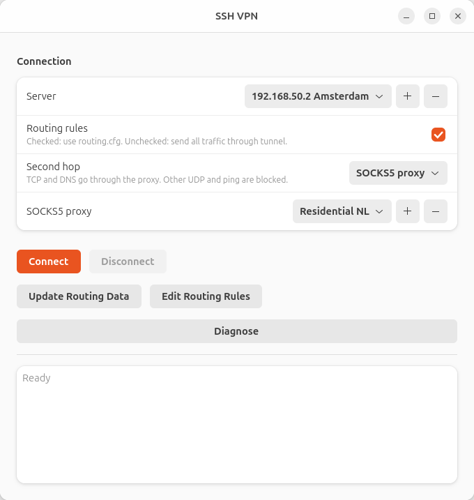

# SSH VPN GUI

SSH VPN GUI turns a Linux VPS you can log in to over SSH into a personal VPN
for your Ubuntu desktop. It carries traffic through an OpenSSH TUN tunnel
(`ssh -w`), prepares the server by itself, and uses your rules to decide, per
domain and per IP address, what goes through the tunnel and what stays on your
normal connection. The server can pass tunnel traffic on through a second hop:
your OpenVPN profile, Tor, or a SOCKS5 proxy.



## Features

- **Saved servers.** Pick a server from a menu where each entry reads
  `IP Notice`. Add servers with **+** and remove them with **−**. Every server
  keeps its own login and password. Choosing another server while connected
  moves the tunnel to it.
- **No manual server setup.** The first connect enables TUN, IPv4 forwarding,
  `PermitTunnel` and NAT on the VPS over SSH.
- **Rule-based or full tunnel.** `routing.cfg` sends domains, Geosite lists,
  IP ranges and GeoIP countries through the tunnel (`proxy`) or around it
  (`direct`). Untick **Routing rules** to send all internet IPv4 traffic
  through the tunnel.
- **Split DNS over TLS.** A local resolver asks Cloudflare or Quad9 over TLS
  and sends each lookup the same way as the domain it is for.
- **Second hop.** Tunnel traffic can leave the VPS through one of your `.ovpn`
  profiles, through Tor, or through one of your SOCKS5 proxies. Profiles and
  proxies are kept in lists, like servers, and can have names. The app
  installs what the server needs.
- **Kill switch.** If the tunnel dies, direct traffic keeps working and
  everything else is blocked at once, even with the window closed, until the
  tunnel is back or you press **Exit and Restore**.
- **Automatic recovery.** A tunnel that died during sleep or lost its SSH
  session is cleaned up and reconnected: eight quick attempts, then once a
  minute.
- **No local password prompts.** Once the package is installed, local
  administrators connect and disconnect without typing their password.

## How it works

```text
                     ssh -w (IPv4 over SSH)
your computer ─────────────────────────────▶ VPS ──▶ Internet
  │                                           │
  │ direct traffic                            └──▶ OpenVPN, Tor or SOCKS5 ──▶ Internet
  ▼                                                (optional second hop)
your normal connection ──▶ Internet
```

- A privileged helper logs in to the server with the saved password, prepares
  it, and starts `ssh -w` under a small root daemon. Both ends take the first
  free `tunN` device and a free `10.255.N.0/30` subnet, so tunnels of other
  VPNs are left alone.
- In rule-based mode, an nftables table marks packets for `proxy`
  destinations and policy routing sends them into the tunnel. Everything else
  uses your normal default route, which the app never rewrites.
- IP and GeoIP rules are loaded into nftables when routing is applied, so
  they also cover cached addresses and connections made without DNS.
- Outgoing DNS queries are redirected to a local resolver that classifies
  every name with your rules and routes the resolved addresses accordingly.
- Full-tunnel mode routes `0.0.0.0/1` and `128.0.0.0/1` into the tunnel.
- Every route into the tunnel has a blackhole route behind it, so a dead
  tunnel blocks traffic instead of leaking it. See
  [When the tunnel drops](#when-the-tunnel-drops).
- The SSH server's own address always stays on your normal connection, so the
  tunnel can never be routed into itself.

## Requirements

### Your computer

- Ubuntu 24.04 LTS or newer, including 26.04 LTS, with a graphical desktop
  session.
- Access to the server's SSH port. Only the standard port 22 is supported.

The Debian package pulls in all local dependencies.

### The server

- A Linux VPS running OpenSSH that accepts **root** login with a password. The
  app needs root on the server to set it up.
- TUN support (`/dev/net/tun`). Some container-based VPS plans keep TUN off
  until you enable it in the provider's control panel. The app cannot turn it
  on from inside the server.

You do not need to edit `sshd_config` or enable `PermitTunnel` yourself. See
[What changes on the server](#what-changes-on-the-server).

## Install

Download the latest `ssh-vpn-gui_<version>_all.deb` from
[Releases](https://github.com/timz-code/ssh-vpn-gui/releases) and install it
from the download directory:

```bash
sudo apt install ./ssh-vpn-gui_*_all.deb
```

Start **SSH VPN GUI** from the application menu or run `ssh-vpn-gui`.

To upgrade, install the newer `.deb` the same way, then quit and reopen the
app. If a tunnel was up during the upgrade, disconnect and connect again so it
runs on the new version. Saved servers and `/etc/ssh-vpn-gui/routing.cfg` are
kept. A
`config.json` from a single-server version is converted to the server list on
first launch, and a saved `.ovpn` file becomes the first entry of the profile
list.

To uninstall, run `sudo apt remove ssh-vpn-gui`. Use
`sudo apt purge ssh-vpn-gui` to also remove `/etc/ssh-vpn-gui/routing.cfg`.

## Quick start

1. Click **+** next to **Server**. Enter the server IP, an optional
   **Notice** such as a city or provider, the login (`root`) and the
   password, then click **Save**. The server appears in the menu as, for
   example, `203.0.113.10 Amsterdam`.
2. Click **Update Routing Data** once. It downloads the GeoIP and Geosite
   data used by `geoip:` and `geosite:` rules.
3. Click **Connect**. The first connect also sets up the server, so it takes
   a little longer. The window title changes to **SSH VPN CONNECTED**.

Saving the same IP and login again replaces the stored password. **−**
deletes the selected server. While connected, **+** and **−** are off, and
choosing another server switches the tunnel to it; see
[Switching servers](#switching-servers).

Closing the window does not disconnect. The tunnel keeps running, and the
window picks it up again the next time you open it. Use **Disconnect** to
stop it. The kill switch keeps working while the window is closed; see
[When the tunnel drops](#when-the-tunnel-drops).

## Switching servers

Choose another server in the menu while connected, and the app moves the
tunnel in one step:

1. It closes the tunnel to the current server and cleans that server up,
   including its second hop. If the server cannot be reached, its cleanup is
   skipped and the switch goes on.
2. It connects to the new server with the same **Routing rules** setting and
   **Second hop**.

While the tunnel moves, traffic meant for it is blocked, so nothing leaks
onto your normal connection. If the new server does not connect, the window
shows why, the block stays, and the app tries the new server again once a
minute until it connects or you press **Exit and Restore**. If you cancel
the password prompt, nothing changes and the menu goes back to the server
you are connected to.

## Routing rules

Rules live in `/etc/ssh-vpn-gui/routing.cfg`. Click **Edit Routing Rules** to
change them in the app: the editor checks the rules before saving and applies
them at once while rule-based routing is on. If you edit the file by hand
(`sudoedit /etc/ssh-vpn-gui/routing.cfg`), reconnect afterwards.

```text
default: proxy
domain(domain:mail.qq.com)->direct
domain(regexp: '(^|[.])yandex[.]com$')->direct
domain(geosite:ru)->direct
ip(203.0.113.0/24)->direct
ip(geoip:private, geoip:ru)->direct
ip(geoip:hk, geoip:mo)->proxy
```

- `proxy` sends matching traffic through the tunnel. `direct` uses your
  normal connection. `default` applies to everything no rule matches.
- Domain and Geosite rules work on plain DNS lookups, which the app
  intercepts. Applying routing rules flushes the system DNS cache so cached
  names are classified again. A browser's built-in "secure DNS" (DNS over
  HTTPS) bypasses domain rules, so turn it off if domain rules seem to be
  ignored. IP and GeoIP rules still apply with secure DNS enabled.
- IP and GeoIP rules match the destination IPv4 address in file order.
  Country rules require the downloaded GeoIP database; a missing or invalid
  database produces an error instead of silently ignoring the rules.
  `geoip:private` is built in, including the `100.64.0.0/10` shared address range.
- DNS queries go over TLS to Cloudflare, with Quad9 as the fallback, along the
  same path as their domain: `proxy` names are resolved through the tunnel and
  `direct` names over your normal connection. IP and GeoIP rules then apply to
  the addresses in the answer.
- `geosite:ru` expands the v2fly `category-ru` list and its nested lists: VK,
  Mail.ru, OK, Yandex, Russian banks, telecom operators, government services
  and more.

**Update Routing Data** downloads the IP66 GeoIP database to
`/var/lib/ssh-vpn-gui/ip66.mmdb` and the v2fly domain-list-community data to
`/var/lib/ssh-vpn-gui/geosite`. Run it from time to time to pick up list
updates.

## Second hop: OpenVPN, Tor or SOCKS5

**Second hop** chooses where the VPS sends the traffic that arrives through
the tunnel:

```text
your computer -> SSH tunnel -> VPS -> second hop -> Internet
```

| Second hop | Tunnel traffic leaves from | What gets through |
| --- | --- | --- |
| None | The VPS's own address | All IPv4 traffic |
| OpenVPN (.ovpn file) | Your VPN provider | All IPv4 traffic |
| Tor | A Tor exit relay | TCP and DNS |
| SOCKS5 proxy | Your proxy | TCP and DNS |

Only traffic that arrives through the tunnel takes the second hop. The
server's own traffic and your SSH session keep using its normal route, and
`direct` traffic stays on your normal connection.

The second hop fails closed on the server. While it starts, and if it stops
later, tunnel traffic is blocked on the server instead of leaving from the
VPS's own address. To bring a stopped hop back, choose it again or reconnect.

After the hop starts, the app checks connectivity and shows the new public IP.
If starting or the check fails, the app stops the hop, and **Second hop**
returns to **None**.

OpenVPN profiles and SOCKS5 proxies are kept in lists, which work like the
server list: **+** adds an entry, **−** removes the chosen one, and the hop
uses the entry chosen in the list. If the list is empty when you choose the
hop, the app asks for the first entry right away. An entry with a name shows
the name instead of its file or address; hover over the list to see which
file or address is chosen.

The choice works while connected:

- Changing **Second hop** starts the new hop without rebuilding the SSH
  tunnel. **None** stops it.
- Choosing another profile or proxy in the list, or adding one with **+**,
  while that hop runs restarts it with the new entry. A new name for the
  running entry does not restart it. **−** is off while connected.
- **Routing rules** switches between `routing.cfg` and full-tunnel mode on the
  fly.
- While disconnected, changes are saved for the next connect. If stopping a
  hop fails, **Second hop** keeps the previous choice.

Switching the second hop changes your public IP, so open connections have to
reconnect. The app clears stale connection-tracking entries on the server so
browsers open fresh sessions right away.

### OpenVPN

Choose **OpenVPN (.ovpn file)** and pick an OpenVPN client profile in the
**OpenVPN config** list. **+** adds one: choose the profile file and,
optionally, a name. Adding the same file again replaces its name. **−** only
takes a profile off the list and leaves the file alone. On the server, the
app then:

1. Installs OpenVPN and conntrack if they are missing (apt, dnf or yum). The
   first install can take several minutes, and its progress is shown in the
   window.
2. Uploads the profile to `/etc/ssh-vpn-gui/client.ovpn` (mode `0600`).
3. Starts the client on the first free `ovpnN` device with OpenVPN's data
   channel offload (DCO) turned off. DCO ignores the requested device name and
   can take over the SSH tunnel's device. The client log goes to
   `/var/log/ssh-vpn-gui-ovpn.log`.
4. Routes tunnel traffic into the client. The route survives OpenVPN's own
   reconnects. If the client exits, tunnel traffic is blocked.

The profile must be self-contained, with certificates and keys inline.
Profiles that ask for a username and password interactively (`auth-user-pass`
without credentials) do not start. Embed the credentials in the file if your
provider needs them.

### Tor

Choose **Tor**. On the server, the app then:

1. Installs Tor, nftables and conntrack if they are missing (apt, dnf or yum;
   on RHEL-based systems Tor comes from EPEL). If the app installed Tor, it
   turns off the distribution's own Tor service.
2. Starts its own Tor client, separate from any Tor service already on the
   server. It uses `/etc/ssh-vpn-gui/torrc`, keeps its data in
   `/var/lib/ssh-vpn-gui/tor` and logs to `/var/log/ssh-vpn-gui-tor.log`.
3. Waits until Tor has connected to the Tor network, for up to three minutes,
   and shows the progress in the window. Later starts reuse the saved data and
   take seconds.
4. Sends TCP from the tunnel into Tor's transparent proxy and DNS queries into
   Tor's DNS resolver.

Tor gives you a different exit address, not Tor Browser's anonymity: cookies,
logins and your browser's fingerprint still identify you. Many sites block or
challenge Tor exit addresses.

### SOCKS5 proxy

Choose **SOCKS5 proxy** and pick a proxy in the **SOCKS5 proxy** list. **+**
adds one: enter an optional name, the proxy's address (an IPv4 address or a
host name), port, and optional login and password. Adding the same address,
port and login again replaces the saved name and password. The VPS connects
to the proxy, so the proxy must be reachable from the server, not just from
your computer. On the server, the app then:

1. Installs redsocks, curl, nftables and conntrack if they are missing. This
   works on Debian and Ubuntu servers. On other systems, install `redsocks`
   yourself.
2. Checks the proxy from the server and shows its exit IP. If the check
   fails, nothing starts.
3. Starts redsocks with `/etc/ssh-vpn-gui/redsocks.conf` (mode `0600`,
   deleted when the hop stops) and logs to
   `/var/log/ssh-vpn-gui-redsocks.log`.
4. Sends TCP from the tunnel through the proxy. DNS queries get a "truncated"
   reply, so resolvers repeat them over TCP, which goes through the proxy.

With Tor or a SOCKS5 proxy, other UDP traffic, QUIC included, is rejected, so
browsers fall back to TCP. Ping does not work. With a SOCKS5 proxy, a
resolver that sends EDNS0 queries through the tunnel, such as
`systemd-resolved` in full-tunnel mode, gets its first answer only after a
few seconds of retries. Rule-based mode resolves names over TLS, which is
TCP, so it is not affected.

## When the tunnel drops

Every route into the tunnel has a blackhole route right behind it. When the
SSH session ends, the kernel removes the tunnel device together with its
routes, and the blackholes take over: traffic meant for the tunnel is dropped
on the spot instead of falling back to your normal connection. This happens
in the kernel, so it does not wait for the app and works with the window
closed. In rule-based mode, direct destinations, your local network and the
SSH server stay reachable. In full-tunnel mode, only your local network and
the SSH server do.

The app checks the tunnel every four seconds and right after the computer
wakes up. When it finds the tunnel dead, it:

1. Cleans up the dead session locally and, if the server is reachable, on the
   server too, including the second hop.
2. Changes the title to **SSH VPN — blocked** and shows **Exit and Restore**
   to the right of **Disconnect**.
3. Reconnects: eight attempts in a row, then once a minute until one
   succeeds. The block stays while it reconnects, and the new tunnel takes
   over from it without a gap.

If the tunnel died while the window was closed, the app opens in the blocked
state. Click **Connect** to bring the tunnel back, or **Exit and Restore** to
return to your normal connection.

**Exit and Restore** removes the block and every routing change, cleans up the
server if it is reachable, and closes the app. Closing the window while
traffic is blocked does the same. **Connect** retries by hand. If it fails,
the block stays.

Routing changes live in memory only, so a reboot starts with your normal
routes and no block.

## What changes on the server

On connect, as root, the app:

- Loads the `tun` module and creates `/dev/net/tun` if needed.
- Turns on IPv4 forwarding (also saved in `/etc/sysctl.conf`), and turns
  forwarding on and reverse-path filtering off on every interface.
- Writes `/etc/ssh/sshd_config.d/99-ssh-vpn-gui.conf` with
  `PermitTunnel point-to-point`, `PermitRootLogin yes` and
  `PasswordAuthentication yes`, checks it with `sshd -t` and reloads SSH. On
  systems without `sshd_config.d`, the same lines are appended to
  `/etc/ssh/sshd_config`.
- Takes the first free `tunN` device and a free `10.255.N.0/30` subnet.
- Allows forwarding for the tunnel subnet and masquerades it on the outgoing
  interface, using nftables or iptables.

A second hop also adds policy routing table `2124` for the tunnel subnet. Tor
and SOCKS5 add the nftables table `ip ssh_vpn_gui_cascade`, which redirects
tunnel traffic to `127.0.0.1`, turn on `route_localnet` for the tunnel device,
and add an iptables `INPUT` rule commented `ssh-vpn-gui-cascade` so that ufw
or a default-drop firewall lets the redirected connections in.

Disconnect stops the second hop and removes the NAT, forwarding,
policy-routing and redirect rules. The SSH and sysctl settings stay in place,
and so do the packages a second hop installed.

## Local administrator rights

TUN, routing and firewall changes need root on your computer. This is
separate from the server password stored in the app.

The package installs a Polkit rule that lets members of `sudo`, `admin` or
`wheel` in an active local session run `/usr/bin/ssh-vpn-helper` without a
password. Installing the package is the one-time authorization. To revoke it:

```bash
sudo rm /usr/share/polkit-1/rules.d/49-ssh-vpn-gui.rules
```

From a source checkout, you can limit the exception to the current user:

```bash
./scripts/install-polkit-rule.sh
```

Or allow passwordless sudo for the helper only:

```bash
./scripts/install-sudoers-rule.sh
```

The app uses `sudo -n` when `/etc/sudoers.d/ssh-vpn-gui` exists and `pkexec`
otherwise. Remove these rules with `./scripts/uninstall-polkit-rule.sh` and
`./scripts/uninstall-sudoers-rule.sh`.

## Troubleshooting

Click **Diagnose**, connected or not, or run the same check in a terminal:

```bash
sudo ssh-vpn-helper diagnose --server SERVER_IP
```

- **Authentication failed:** check the IP, login and password. The server
  must accept root password logins before the first connect.
- **Connection timed out:** check that port 22 on the server is reachable.
- **Tunnel device open failed:** the VPS provider has TUN turned off.
- **Routing data missing:** click **Update Routing Data**.
- **Second hop does not start:** the error ends with the last lines of the
  hop's log. The full logs are on the server in
  `/var/log/ssh-vpn-gui-ovpn.log`, `/var/log/ssh-vpn-gui-tor.log` and
  `/var/log/ssh-vpn-gui-redsocks.log`.
- **Traffic is blocked and you want your normal connection back without the
  app:** run `sudo ssh-vpn-helper disconnect --local-only`.

Check the tunnel without changing anything:

```bash
ssh-vpn-helper status
```

Print the commands a connect would run, without running them:

```bash
printf '%s\n' 'test' |
  sudo ssh-vpn-helper connect --dry-run --server 203.0.113.10 \
  --password-stdin
```

## Build the Debian package

Clone the repository, open a terminal in its root directory, and install the
build dependencies:

```bash
sudo apt update
sudo apt install -y build-essential debhelper devscripts dh-python \
  pybuild-plugin-pyproject python3-all python3-pytest python3-setuptools \
  python3-wheel
```

Build and install:

```bash
dpkg-buildpackage -us -uc
sudo apt install ./../ssh-vpn-gui_*_all.deb
```

The package installs:

- GUI launcher: `/usr/bin/ssh-vpn-gui`
- Privileged helper: `/usr/bin/ssh-vpn-helper`
- Routing rules: `/etc/ssh-vpn-gui/routing.cfg`
- Desktop entry, icon, Polkit policy and Polkit rule under `/usr/share`

## Development

Install the local system dependencies:

```bash
sudo apt update
sudo apt install -y python3-gi gir1.2-gtk-4.0 gir1.2-adw-1 python3-venv \
  openssh-client nftables polkitd pkexec
```

Create an environment and run the tests:

```bash
python3 -m venv --system-site-packages .venv
. .venv/bin/activate
pip install -e '.[test]'
pytest
```

PyGObject comes from Ubuntu's `python3-gi` package rather than from PyPI.

## Security notes

- The app changes the server as root, including allowing root login with a
  password over SSH. Use a server dedicated to this purpose.
- Saved servers and SOCKS5 proxies, passwords included, are stored
  unencrypted in `~/.config/ssh-vpn-gui/config.json` with mode `0600`. The
  `.ovpn` profile and the SOCKS5 password reach the server inside the SSH
  session and are kept there in files only root can read.
- A server's host key is accepted on the first connect and stored in
  `/var/lib/ssh-vpn-gui/known_hosts`. A changed key is rejected.
- The tunnel carries IPv4 only, so outgoing IPv6 is rejected in both modes
  while the app manages routing; otherwise it would bypass the tunnel.
- Full-tunnel mode leaves your DNS settings untouched, so a resolver on your
  local network is still queried directly.
- The kill switch does not need the app to be running, but it does not
  survive a reboot. See [When the tunnel drops](#when-the-tunnel-drops).

## License

SSH VPN GUI is licensed under the
[GNU General Public License version 3](LICENSE).
